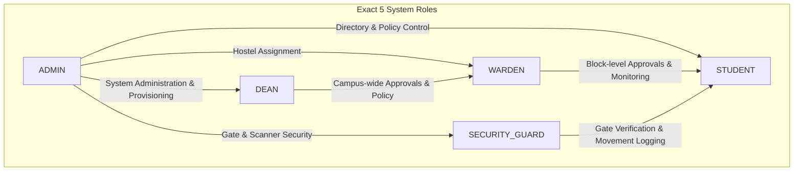
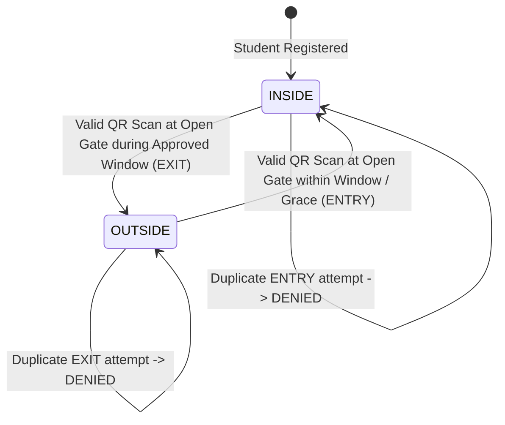
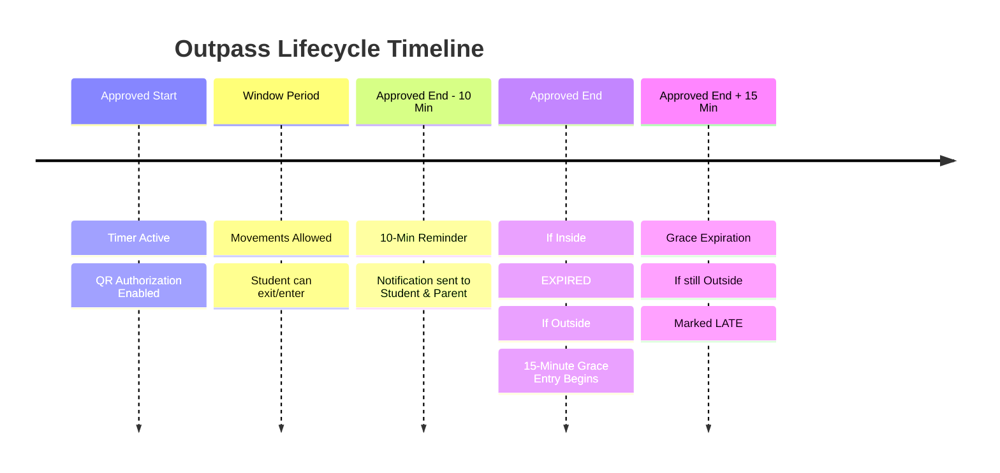

# System Architecture: Hostel Outpass Management Dashboard

## 1. Executive Summary & Design Goals
The **Hostel Outpass Management Dashboard** is an enterprise-grade full-stack web platform architected for colleges and universities to manage student outpass requests, multi-day flexible home leaves, gate movements, fixed turnstile scanners, and security compliance.

The platform is designed to handle **5,000+ to 50,000+ students** with strict server-side authentication, role-based access control (RBAC), and authoritative server time enforcement.

---

## 2. Strict Role Hierarchy & Boundary Isolation
The system defines **EXACTLY FIVE** roles. No other roles exist.

### Critical Boundaries
1. **TEACHER ROLE IS COMPLETELY REMOVED**: No teacher login, no teacher model, no teacher routes, no teacher database records.
2. **PARENT IS NOT A LOGIN ROLE**:
   - Parents have contact-only status linked to student profiles.
   - Used for automated notification dispatch (Outpass approved, gate movements, overdue return alerts).
   - Students can view parent details but **cannot edit** them.
   - Wardens/Deans/Admins can modify parent details only with a **mandatory audit reason**.
3. **Role Cross-Check on Login**:
   - Every login requires both credentials and the portal role.
   - If a Student attempts to log in at the Warden, Dean, Admin, or Guard portal, the backend immediately rejects the attempt with a 403 error and logs a `WRONG_ROLE_LOGIN_ATTEMPT` security event.
   - Role switching after login is strictly prohibited.

---

## 3. Movement State Machine & Transition Rules

Movement transitions are atomic, auditable, and idempotent:

### Transition Enforcement
- **If INSIDE**: Only `EXIT` is permitted. Attempting `ENTRY` returns `DENIED: Student is already recorded as INSIDE`.
- **If OUTSIDE**: Only `ENTRY` is permitted. Attempting `EXIT` returns `DENIED: Student is already recorded as OUTSIDE`.
- **Replay Protection**: Duplicate scans within 3 seconds for the same student are blocked.
- **Multiple Entry/Exit**: Short active outpasses permit multiple valid movements (e.g. exit 2:10 PM -> enter 3:00 PM -> exit 4:00 PM -> enter 4:40 PM) as long as alternating and within the approved window.

---

## 4. Authoritative Server Timer & Expiry Workflow

1. **Timer Authority**: The timer is based strictly on **Approved Start Time** and **Approved End Time** set on the server. First exit **never shifts or extends** the expiry deadline.
2. **10-Minute Return Reminder**: Background reconciliation job sends notification when current server time is within 10 minutes of `approved_end_time` if the student is currently `OUTSIDE`.
3. **15-Minute Grace Entry Window**:
   - If student is `INSIDE` at expiry: outpass is marked `EXPIRED` (completed).
   - If student is `OUTSIDE` at expiry: transitions into `GRACE_ENTRY` mode for 15 minutes.
   - Entering during grace: scan is `ALLOWED`, outpass records `grace_extension_used = true` and `return_status = 'ON_TIME'`.
   - After 15 minutes without return: outpass transitions to `LATE`, computes `late_minutes`, and alerts Warden/Dean/Parents.
4. **No-Show Detection**: If approved outpass period ends and the student never performed an exit scan, the pass is automatically marked `NO_SHOW`.

---

## 5. Flexible Home Leave (Dynamic Duration)
- Home leaves are **never hardcoded** to 10 days or 30 days.
- Students pick custom departure and return dates/times.
- System dynamically computes `approved_duration_minutes = (return_datetime - start_datetime)`.
- Valid for 2 days, 7 days, 15 days, 30 days, 45 days, or any duration authorized by institutional policy.

---

## 6. Fixed Gate Scanner Security
- Scanners (e.g., `SCANNER-001`) are registered to specific physical Gates (`GATE-001`).
- Scanners authenticate with hashed API keys (`api_key_hash`) using `x-scanner-code` and `x-api-key` headers.
- Gate state (`OPEN`, `CLOSED`, `MAINTENANCE`) is verified on every scan. Closed gates immediately reject movement.
- **Guard Operational Privacy**: Guards see only operational verification info (Student name, roll number, hostel room, status, movement decision). Guards **never see** parent phone numbers, emails, or student full database records.

---

## 7. Scalability Architecture (5,000+ Students)
1. **Server-Side Pagination & Search**: APIs query with `skip`, `limit`, and indexed regex queries. The frontend never loads all students at once.
2. **High-Performance MongoDB Compound Indexes**:
   - `User`: `{ college_id: 1, role: 1 }`
   - `Student`: `{ hostel: 1, block: 1 }`, `{ movement_status: 1 }`, `{ status: 1 }`
   - `OutpassRequest`: `{ student_id: 1, status: 1 }`, `{ expires_at: 1 }`
   - `ScanLog`: `{ student_id: 1, scanned_at: -1 }`, `{ gate_id: 1, scanned_at: -1 }`
3. **Bulk CSV Import**: Batched chunk processing (50 records per chunk) with row-level validation and duplicate detection. Role is strictly forced to `STUDENT` to prevent privilege escalation.
